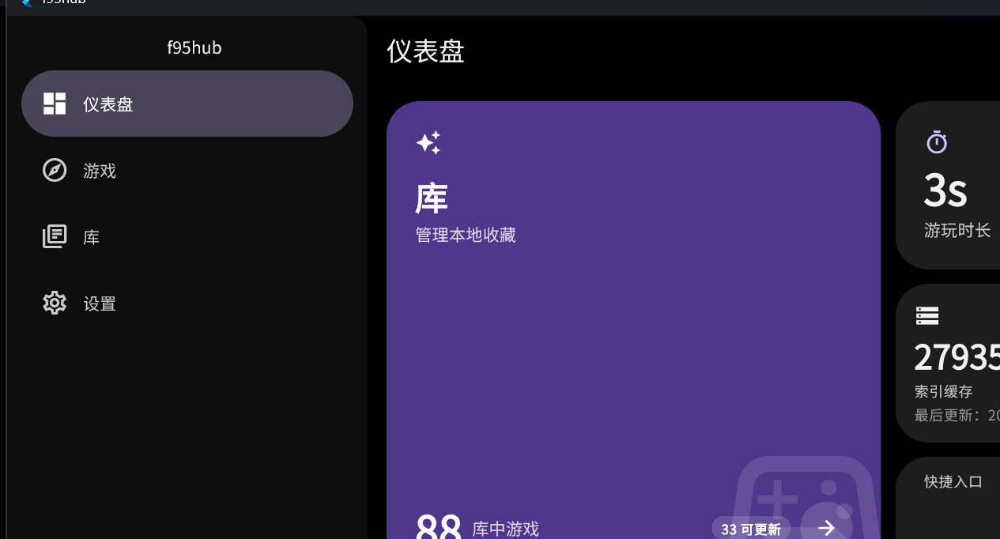
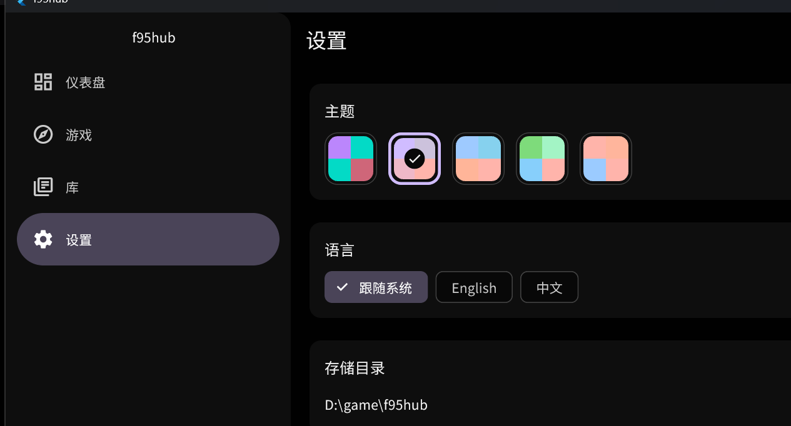

# f95hub

A native desktop client for browsing [f95zone](https://f95zone.to) — the games
listing, thread details, and a local library — built with Flutter.

> **Unofficial, personal-use client.** Not affiliated with f95zone. Use it at
> your own risk and respect the site's terms. The app contains adult (NSFW)
> content; screenshots below may too.



## Features

- **Browse the catalogue** — paged games listing with server-side sort
  (date / likes / views / title / rating), tag / engine / status / date filters,
  and a local title search.
- **Game details** — cover, screenshots, resolved tags and engine, developer,
  release / last-updated dates, description, and a one-tap *Open in browser* to
  the original thread.
- **Library** — import games (scrape a listing into a local entry), detect
  updates against the catalogue, track playtime sessions, pick launch entries,
  and keep local versions side by side with the latest.
- **Offline index** — a cached catalogue used for instant local search and for
  update detection, resumable page by page.
- **Wide + narrow layouts** — a permanent sidebar with a tabbed detail pane on
  wide windows; a drawer + pushed details on narrow ones.
- **Themes and languages** — Material 3 with several color presets, light/dark
  modes, and English / 简体中文 (CJK-optimized typography).
- **Desktop first** — Windows (primary) and Linux; no in-app downloads — the
  app opens the thread and you download from the source.

## Screenshots

| Dashboard | Settings |
| --- | --- |
|  |  |

## Requirements

- Flutter **3.47+** (Dart 3.8), desktop enabled.
- Windows 10/11 (primary) or a Linux desktop with GTK 3.
- Optional: an f95zone session cookie for logged-in pages (the app works
  signed-out for the public listing).

## Getting started

```bash
flutter pub get
flutter run -d windows   # or -d linux
```

The generated translations (`lib/i18n/*.g.dart`) are committed; if you edit
`i18n/*.i18n.json`, regenerate them with:

```bash
dart run slang
```

## Building

```bash
flutter build windows --release
# → build/windows/x64/runner/Release/
```

## How it works

The app is layered around three small ports (`lib/domain/ports.dart`):

- `MetadataSource` — the f95zone adapter. It parses the `latest_data.php`
  listing endpoint and the thread pages; requests are paced to stay clear of the
  site's rate limiting.
- `LibraryStore` — the local SQLite (drift) holding games, versions, play
  sessions, and the cached catalogue index.
- `AppLauncher` / `ProcessRunner` — OS-level folder opening and game launching.

State lives in Riverpod notifiers (`lib/state/`), and the UI (`lib/pages/`,
`lib/widgets/`) reads it through providers. Widget tests and golden tests cover
the pages; the ports are faked in tests, so no network is needed.

## Data & privacy

- The **session cookie** is kept in memory only and is never written to disk.
- The **config** (theme, language, storage directory, request pacing) is a
  plain JSON file and holds no secrets.
- The **library**, **play sessions**, and **catalogue index** live in a local
  SQLite database in the platform's application-support directory.

## Disclaimer

This is an unofficial hobby client. It does not host or bundle any content; it
only browses and stores metadata that the user chooses to keep locally. Respect
f95zone's terms of service and the rights of the content creators.

## License

[MIT](LICENSE)
